# NIVAS — Shared System Architecture & Integration Contract

> **Target Repository:** `https://github.com/prastogidev/CatalystHack`  
> **Source Platform:** NIVAS Unified Property and Neighbourhood Intelligence  
> **Production Reference:** `https://nivas-one.vercel.app`

---

## 1. Architectural Overview & System Topology

NIVAS is a unified property and neighbourhood intelligence platform that bridges the gap between individual physical building inspections and systemic urban-environmental realities. The system evaluates a property across five orthogonal domains:

1. **Physical Condition:** Computer vision wall condition defect detection & MLX90640 thermal array anomaly analysis.
2. **Livability & Infrastructure:** OpenStreetMap Overpass amenities (hospitals, schools, transit) within dynamic distance radii.
3. **Environmental Telemetry:** WAQI / AQICN station monitoring and OpenWeather meteorology.
4. **Safety & Disaster Exposure:** NCRB 2022 crime statistics, Delhi Police district ray-casting, and 8 national disaster hazard layers.
5. **Valuation & Legal Authenticity:** Circle rate valuation models, cached benchmarks, and Document Intelligence OCR deed verification.

```mermaid
flowchart TD
    User([User / Browser])
    
    subgraph Team_01 ["Team 01: Frontend & UX (React / Vite)"]
        UI[Workspace Navigation & Dashboards]
        Pick[PropertyLocationPicker]
        LiveUI[Livability Workspace]
        SafeUI[Safety & Disaster View]
        InspUI[Property Inspection & Thermal UI]
        DocUI[Document Intelligence UI]
        ChatUI[Neighborhood AI Advisor Chat]
    end

    subgraph Gateway ["FastAPI Orchestrator Gateway"]
        CORS[CORS & Timing Middleware]
        Health["/health Endpoint"]
    end

    subgraph Team_02 ["Team 02: Backend Core & Valuation"]
        ScoreAPI["POST /api/score/property"]
        CompAPI["POST /api/score/compare"]
        ScoringSvc[scoring.py - Composite Weights]
        DecisionSvc[decision.py - Explainable AI Flags]
        PriceSvc[price.py - Propstack & Circle Rates]
        ReportSvc[report.py - Assessment Summaries]
        CompareSvc[compare.py - Symmetric Deltas]
    end

    subgraph Team_03 ["Team 03: Location & Environment"]
        LiveAPI["GET /api/livability/data"]
        CoordAPI["GET /api/livability/coordinates"]
        LocSvc[location.py - Overpass OSM Engine]
        GeoSvc[geocoding.py - Nominatim Cache]
        WeatherSvc[weather.py - OpenWeather Telemetry]
        AQISvc[aqi.py / air_quality.py - WAQI & AQI]
    end

    subgraph Team_04 ["Team 04: Safety & Disaster"]
        DisasterAPI["GET /api/disaster/hazards"]
        LayersAPI["GET /api/disaster/layers"]
        SafetyAPI["GET /api/disaster/safety"]
        CrimeSvc[crime_data.py - NCRB & Ray-casting]
        DisasterSvc[disaster.py - Hazard Intersections]
        GISData[Static GeoJSON & JSON Baseline Datasets]
    end

    subgraph Team_05 ["Team 05: AI, Documents & Inspection"]
        DocAPI["POST /api/documents/extract"]
        VerifyAPI["POST /api/documents/cross-verify"]
        ChatAPI["POST /api/livability/chat"]
        AdvisorSvc[livability_advisor.py - Gemini 3.5 / OpenAI]
        DocSvc[document_analysis.py - Tesseract & Fuzzy]
        CVSvc[cv_model.py - EfficientNet-B0 Classifier]
        ThermalSvc[thermal.py - MLX90640 Median Filter]
    end

    User --> UI
    UI --> CORS
    CORS --> ScoreAPI
    CORS --> LiveAPI
    CORS --> DisasterAPI
    CORS --> DocAPI
    CORS --> ChatAPI

    ScoreAPI --> ScoringSvc
    ScoreAPI --> PriceSvc
    ScoreAPI --> LocSvc
    ScoreAPI --> CVSvc
    ScoreAPI --> ThermalSvc
    ScoreAPI --> DecisionSvc

    LiveAPI --> LocSvc
    LiveAPI --> WeatherSvc
    LiveAPI --> AQISvc

    DisasterAPI --> DisasterSvc
    SafetyAPI --> CrimeSvc
    DisasterSvc --> GISData
    CrimeSvc --> GISData

    ChatAPI --> AdvisorSvc
    DocAPI --> DocSvc
```



---

## 2. Frontend-to-Backend Network Protocol

1. **Protocol:** HTTP/1.1 REST API + JSON payloads.
2. **Base URL Configuration:**
   - Frontend reads `VITE_API_URL` from `.env.local` or environment (e.g. `http://localhost:8000`).
   - Default fallback: `http://localhost:8000` for local development.
   - Production URL: `https://nivas-one.vercel.app`.
3. **CORS Policy:**
   - FastAPI allows origins `*`, credentials `True`, methods `*`, headers `*`.
   - Every response includes `X-Process-Time` (in seconds).
4. **Error Schema Contract:**
   All 4xx/5xx responses adhere to FastAPI's standard error envelope:
   ```json
   {
     "detail": "Descriptive human-readable error explanation",
     "error": "Optional internal trace or code"
   }
   ```

---

## 3. Canonical API Endpoint Contracts

### 3.1 Composite Scoring & Valuation (Team 02)
* **`POST /api/score/property`**
  * **Payload (`ScoreRequest`):**
    ```json
    {
      "address": "Pocket 1, Sector 12 Dwarka, New Delhi",
      "property_type": "residential",
      "carpet_area_sqft": 1250.0,
      "price_inr": 12500000.0,
      "coordinates": {"lat": 28.5921, "lon": 77.0460},
      "image_urls": ["data:image/jpeg;base64,..."],
      "thermal_data": [[24.5, 25.1, ...]],
      "radius_meters": 1200
    }
    ```
  * **Response (`ScoreResponse`):**
    ```json
    {
      "property_id": "prop_12345",
      "overall_score": 82.5,
      "grade": "A",
      "status": "complete",
      "defect_score": 90.0,
      "thermal_score": 85.0,
      "location_score": 78.0,
      "environmental_score": 70.0,
      "price_valuation": {
        "status": "active",
        "benchmark_price_per_sqft": 9500.0,
        "price_ratio": 1.05,
        "valuation_conclusion": "fair"
      },
      "decision_insights": {
        "flags": [],
        "confidence": 0.92,
        "recommendation": "Favorable investment"
      }
    }
    ```
* **`POST /api/score/compare`**
  * **Payload (`CompareRequest`):** Pair of property objects (`property_a`, `property_b`).
  * **Response (`CompareResponse`):** Metric-by-metric delta, symmetric evaluation, and comparative risk breakdown.

### 3.2 Location & Environmental Intelligence (Team 03)
* **`GET /api/livability/data`**
  * **Query Parameters:** `lat` (float), `lon` (float), `radius` (int, default: 1200), `address` (optional string).
  * **Response (`LivabilityDataResponse`):**
    ```json
    {
      "address": "Dwarka Sector 12, Delhi",
      "coordinates": {"lat": 28.5921, "lon": 77.0460},
      "radius_meters": 1200,
      "facilities": [
        {
          "name": "Venkateshwar Hospital",
          "category": "healthcare",
          "distance_meters": 450,
          "lat": 28.5901,
          "lon": 77.0435
        }
      ],
      "category_counts": {"healthcare": 8, "education": 12, "transit": 6},
      "weather": {
        "temperature_c": 28.4,
        "humidity_pct": 52,
        "condition": "Haze",
        "fetch_status": "active"
      },
      "aqi": {
        "aqi_value": 164,
        "category": "Unhealthy",
        "station_name": "Dwarka Sector 8, Delhi",
        "source": "WAQI / AQICN",
        "fetch_status": "active"
      }
    }
    ```
* **`GET /api/livability/coordinates`**
  * **Query Parameters:** `address` (string).
  * **Response:** `{"lat": 28.5921, "lon": 77.0460, "display_name": "Sector 12 Dwarka..."}`.

### 3.3 Safety & Disaster Intelligence (Team 04)
* **`GET /api/disaster/hazards`**
  * **Query Parameters:** `lat` (float), `lon` (float).
  * **Response (`HazardAssessment`):**
    ```json
    {
      "coordinates": {"lat": 28.5921, "lon": 77.0460},
      "overall_hazard_score": 35.0,
      "seismic_zone": "Zone IV",
      "flood_susceptibility": "Low",
      "cyclone_zone": "Moderate Damage Risk Zone",
      "landslide_susceptibility": "Low",
      "heatwave_exposure_days": 18,
      "drought_stress": "Semi-Critical",
      "waterlogging_hotspots_nearby": 0,
      "yamuna_floodplain_distance_km": 14.2
    }
    ```
* **`GET /api/disaster/safety`**
  * **Query Parameters:** `lat` (float), `lon` (float).
  * **Response (`LocalitySafetyResponse`):**
    ```json
    {
      "police_district": "Dwarka",
      "reported_ipc_rate_per_lakh": 412.5,
      "safety_score": 78.0,
      "nearest_police_stations": [
        {"name": "Dwarka South Police Station", "distance_meters": 620}
      ],
      "data_source": "NCRB 2022 & Delhi Police GIS"
    }
    ```
* **`GET /api/disaster/safety/national`**
  * **Response:** India-wide crime baseline indices by State and Union Territory.

### 3.4 AI, Documents & Property Inspection (Team 05)
* **`POST /api/livability/chat`**
  * **Payload:**
    ```json
    {
      "message": "Is this area safe for families with young children?",
      "context": {
        "address": "Dwarka Sector 12",
        "facilities": [...],
        "safety": {...},
        "disaster": {...}
      }
    }
    ```
  * **Response:**
    ```json
    {
      "reply": "Dwarka Sector 12 offers strong educational infrastructure with 12 schools within 1.2 km...",
      "provider": "google-gemini",
      "model": "gemini-3.5-flash",
      "suggested_inquiries": [
        "What are the nearest metro connectivity points?",
        "How does the local AQI compare to Delhi averages?"
      ]
    }
    ```
* **`POST /api/documents/extract`**
  * **Form Data:** Multi-part file upload (`file: UploadFile`).
  * **Response:** Extracted text, identified deed clauses, property title, party names, survey numbers, and confidence.
* **`POST /api/documents/cross-verify`**
  * **Payload:** Extracted entities from Title Deed vs. Sale Agreement vs. Encumbrance Certificate.
  * **Response:** Cross-verification matrix, title continuity status, discrepancy list.

---

## 4. Shared Environment Variables Standard

All teams use these unified environment variable keys. Never invent alternative names:

| Variable Name | Required By | Format / Example | Description |
| :--- | :--- | :--- | :--- |
| `VITE_API_URL` | Team 01 (Frontend) | `http://localhost:8000` | Target backend REST URL |
| `GEMINI_API_KEY` | Team 05 (AI Advisor) | `<google_gemini_api_key>` | Google Gemini API key |
| `GEMINI_MODEL` | Team 05 (AI Advisor) | `gemini-3.5-flash` | Generative model ID |
| `OPENAI_API_KEY` | Team 05 (AI Advisor) | `<openai_api_key>` | Optional fallback LLM key |
| `OPENWEATHER_API_KEY` | Team 03 (Location) | `<openweather_api_key>` | Weather and pollution API key |
| `AQICN_TOKEN` | Team 03 (Location) | `<aqicn_token>` | WAQI / AQICN station token |
| `PROPSTACK_API_KEY` | Team 02 (Core) | `<propstack_api_key>` | Optional real estate benchmark API |
| `HOST` | Backend Teams | `0.0.0.0` | Server bind host |
| `PORT` | Backend Teams | `8000` | Server bind port |

> **Security Rule:** Actual credential values are **strictly forbidden** from Git commits, pull requests, test fixtures, and documentation. Use `.env.example` templates with empty values only.

---

## 5. Module Boundaries & Forbidden Cross-Modifications

To ensure five teammates can work simultaneously without Git merge conflicts:

| Team Package | Allowed File Scope | Strictly Forbidden Modifications |
| :--- | :--- | :--- |
| **Team 01 (Frontend)** | `frontend/**` (all UI, CSS, components, tests) | Backend files (`backend/**`), data files |
| **Team 02 (Backend Core)** | `backend/main.py`, `backend/core/**`, `backend/api/score.py`, `backend/models/score.py`, `backend/services/scoring.py`, `decision.py`, `price.py`, `report.py`, `compare.py` | Overwriting Team 03/04/05 domain services |
| **Team 03 (Location)** | `backend/services/location.py`, `geocoding.py`, `weather.py`, `aqi.py`, `air_quality.py`, `backend/models/livability.py` | Modifying `scoring.py`, `disaster.py`, or frontend |
| **Team 04 (Safety & Disaster)** | `backend/services/crime_data.py`, `backend/services/disaster.py`, `backend/models/safety.py`, `disaster.py`, `backend/data/crime/**`, `backend/data/disaster/**` | Modifying `livability_advisor.py`, `score.py`, or UI |
| **Team 05 (AI & Inspection)** | `backend/services/livability_advisor.py`, `document_analysis.py`, `cv_model.py`, `thermal.py`, `backend/cv/**`, `cv_pipeline/**`, `backend/models/documents.py`, `data/wall_condition_dataset/**` | Modifying core valuation math or location queries |

---

## 6. Integration Contract & Quality Targets

When all 5 modules are combined into the unified repository:
1. **Backend Tests:** All 192 unit and integration tests must pass:
   ```bash
   pytest backend/tests/
   ```
2. **Frontend Tests:** All 99 Vitest test cases must pass:
   ```bash
   cd frontend && npm test -- --run
   ```
3. **Production Build:** Vite production bundle must build in <2 seconds with 0 warnings:
   ```bash
   cd frontend && npm run build
   ```
